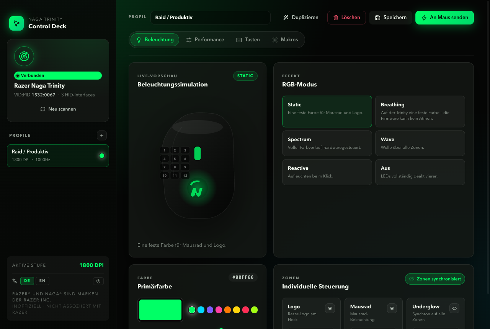

# Razer Naga Trinity – macOS Controller



Electron + React app for the **Razer Naga Trinity (VID `0x1532`, PID `0x0067`)** on macOS, without Razer Synapse. Not affiliated with Razer; community reverse-engineering project.

## Features

| Feature | On the mouse | In the app |
|---|---|---|
| RGB (scroll wheel + logo), several effects | lost on unplug (firmware limit, same with Synapse) | ✅ re-applied on start, unlock/wake and re-plug; optional off on lock |
| DPI stages, active stage | stored | ✅ live readout follows DPI+/DPI− |
| Polling rate (125 / 500 / 1000 Hz) | stored | ✅ |
| Side buttons, 12- and 7-button plate: key, combo (`Shift+1`), Mouse 1–5 or macro | stored | ✅ read back after every write |
| Wheel tilt left/right | stored | ✅ Browser back/forward |
| Macros (multi-step text) | – | ✅ side button sends F13–F24, app types the text; each macro shows its button and whether it is active |
| Side buttons on the 2-button plate, base buttons, profile slots, per-key RGB | – | 🚧 not yet |

Also: menu-bar mode with open at login, app menu with shortcuts (⌘S save, ⌘↩ send to mouse, ⌘N / ⌘D new / duplicate profile, ⌘1–⌘4 sections, ⌘, settings), German and English UI.

DPI, polling rate and button bindings stay on the mouse after unplug or reboot. RGB and macros need the app running.

## Requirements

- macOS 13 or newer; tested on **macOS 27.2** (Apple silicon)
- Node 20+ (tested with Node 26)
- Razer Naga Trinity, wired

## Install and run

```bash
git clone git@github.com:cepheiden/Razer-Naga-Trinity-MACOS.git
cd Razer-Naga-Trinity-MACOS
npm install
npm run dev                # or: npm run build && npm run electron:pack → release/mac-arm64/Naga Trinity Control.app
```

1. Plug in the mouse and click **Send to mouse** (⌘↩). RGB, DPI, polling rate and side buttons are written.
2. The first macro asks for **Accessibility** access (System Settings → Privacy & Security → Accessibility). Grant it to *Naga Trinity Control* (or *Electron* when running `npm run dev`) and restart the app.
3. In **Settings** (⌘,) turn on *Open at login*; the app then lives in the menu bar and applies the active profile on every start.

The packaged app is unsigned. For distribution, add your Developer ID to the `electron-builder` config in `package.json`.

### Development

```bash
npx tsc -b              # renderer + main process (strict)
npm run lint
npm test                # vitest: key parsing, side bindings, store migration
scripts/snapshot.sh     # one PNG per page in docs/snapshots/ (own data folder, no USB writes)
npm run icon            # compile Icon/AppIcon.icon (Xcode 26+)
```

Changes per version: [CHANGELOG.md](CHANGELOG.md). Architecture: [ARCHITECTURE.md](ARCHITECTURE.md). Protocol details and hardware findings: [CLAUDE.md](CLAUDE.md).

## Troubleshooting

- **Macro fires but nothing is typed**: Accessibility access is missing. Grant it and restart the app.
- **Side button still sends `1`–`9` after setting a macro**: click *Send to mouse*; bindings are only written on apply.
- **Lights are off after re-plugging**: the app restores them within about 2 seconds if it is running. The firmware cannot store RGB.
- **`cannot open device … DevSrvsID`**: another instance of the app is running.

## How it works

The app talks to the mouse with libusb control transfers on endpoint 0, which macOS leaves open, so no Input Monitoring permission is needed. All USB access goes through one queue.

Side-button bindings use the command decoded from a Synapse 3 USB capture (`cls 0x02 cmd 0x0c`, written to slot 2 and then slot 1, read back with `cmd 0x8c` and retried). Each plate has its own source IDs (12-button `0x40`–`0x4b`, 7-button `0x50`–`0x56`). For a macro, the button is bound to F13–F24, which macOS does not use; the app catches the key with `globalShortcut` and types the text with `osascript`.

## Credits

- **[Ole Christian Rynning (@oc)](https://github.com/oc)**, [PR #1](https://github.com/cepheiden/Razer-Naga-Trinity-MACOS/pull/1): 7-button plate source IDs, key/combo/mouse side-button bindings, serialized USB access with read-back and retry.
- **[OpenRazer](https://github.com/openrazer/openrazer)**: the reverse-engineering base, in particular [`razermouse_driver.c`](https://github.com/openrazer/openrazer/blob/master/driver/razermouse_driver.c) (Trinity static effect, transaction IDs), [`razerchromacommon.c`](https://github.com/openrazer/openrazer/blob/master/driver/razerchromacommon.c), the [Trinity daemon class](https://github.com/openrazer/openrazer/blob/master/daemon/openrazer_daemon/hardware/mouse.py), [PR #888](https://github.com/openrazer/openrazer/pull/888) (daemon-side RGB state) and [issue #541](https://github.com/openrazer/openrazer/issues/541).
- **Razer**: [Insider forum on on-board memory](https://insider.razer.com/mice-and-surfaces-9/naga-trinity-on-board-memory-9754), [Naga Trinity master guide](https://dl.razerzone.com/master-guides/RazerSynapse/NagaTrinity-00000103-en.pdf). The binding command was taken from a Wireshark/USBPcap capture of Synapse 3; only the bytes on the wire were reproduced.
- **Libraries**: Electron 42, React 19, Vite 8, TypeScript 6, [`usb`](https://github.com/node-usb/node-usb) (libusb, N-API prebuilds, no native build step), Zustand, i18next, vitest.
- Developed with [Claude Code](https://claude.com/claude-code) (Claude Opus 5.5).

## Trademarks and license

**Razer** and **Naga** are trademarks of **Razer Inc.**, used only to name the compatible hardware. This project is not affiliated with, endorsed or sponsored by Razer Inc. Razer's own software is [Razer Synapse](https://www.razer.com/synapse-3).

MIT, see [LICENSE](./LICENSE). The license covers this repository's source code only, not Razer's trademarks or firmware.
